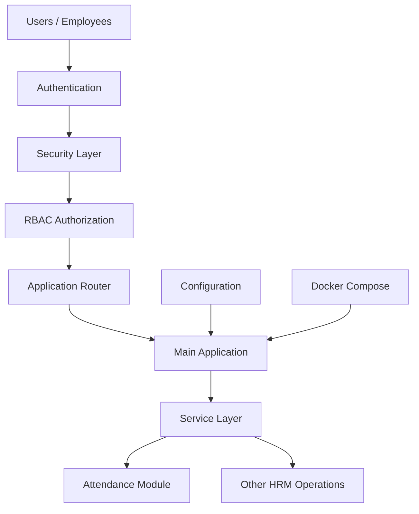
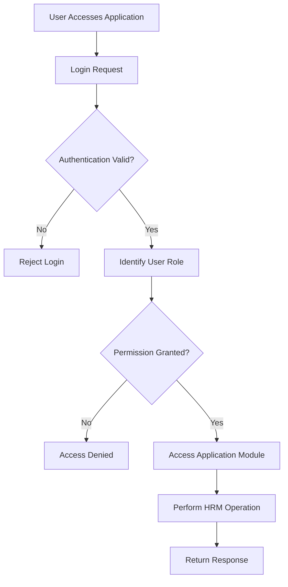

# 🚀 Smart HRM System

### Intelligent Human Resource Management Platform

**Smart HRM System** is a modular Human Resource Management platform designed to streamline employee administration, authentication, attendance management, role-based access control, and organizational operations.

The project focuses on modular architecture, secure authentication, maintainable application design, and containerized deployment using Docker.

---

## 📌 Table of Contents

- [Project Overview](#-project-overview)
- [Key Features](#-key-features)
- [Technology Stack](#-technology-stack)
- [Project Architecture](#-project-architecture)
- [Project Structure](#-project-structure)
- [Module Documentation](#-module-documentation)
- [Installation and Setup](#-installation-and-setup)
- [Docker Deployment](#-docker-deployment)
- [Application Workflow](#-application-workflow)
- [Security Architecture](#-security-architecture)
- [Development Roadmap](#-development-roadmap)
- [Contribution Guidelines](#-contribution-guidelines)

---

## 🎯 Project Overview

Smart HRM is designed to provide a centralized platform for managing essential human resource operations.

The system separates authentication, security, application routing, business services, and attendance functionality into dedicated modules.

### Project Objectives

- Simplify employee and organizational management.
- Provide centralized authentication.
- Implement Role-Based Access Control (RBAC).
- Organize attendance-related operations.
- Maintain modular and reusable application components.
- Support containerized application deployment.
- Establish a foundation for scalable HR management services.

---

## ✨ Key Features

| Feature | Description |
|:---|:---|
| 🔐 Authentication | Centralized user authentication functionality |
| 🛡️ Security | Security-related application components |
| 👥 Access Control | Role-Based Access Control (RBAC) |
| ⏱️ Attendance | Employee attendance management functionality |
| 🔀 Routing | Modular application routing |
| ⚙️ Configuration | Centralized application configuration |
| 🧩 Service Layer | Separation of application service operations |
| 🐳 Containerization | Docker Compose-based deployment configuration |

---

## 🛠️ Technology Stack

| Technology | Purpose |
|:---|:---|
| Python | Application development |
| Docker | Application containerization |
| Docker Compose | Container orchestration for local deployment |
| Git & GitHub | Version control and collaboration |
| RBAC | Authorization architecture |

*Note: The technology list should be updated when additional dependencies and infrastructure components are confirmed.*

---

## 🏗️ Project Architecture

The application follows a modular structure in which different responsibilities are separated into individual Python modules.



### Architectural Components

**1. Authentication Layer**

Responsible for user authentication and login-related operations.

**2. Security Layer**

Contains security-related application functionality.

**3. Authorization Layer**

Provides the foundation for role-based permission management.

**4. Routing Layer**

Organizes application endpoints and request handling.

**5. Service Layer**

Separates business operations from application entry points.

**6. Attendance Module**

Contains functionality related to attendance management.

---

## 📂 Project Structure

```text
smart-hrm-system/
│
├── Auth.py
├── Security.py
├── Service.py
├── atten.py
│
├── config.py
├── login.py
├── main.py
│
├── patient.py
├── rbac.py
├── router.py
├── serviceauth.py
│
├── compose.yml
│
└── README.md
```

### 📑 Module Documentation

| File | Responsibility | Description |
|:---|:---|:---|
| [Auth.py](Auth.py) | Authentication | Authentication-related operations |
| [Security.py](Security.py) | Security | Security functionality and controls |
| [Service.py](Service.py) | Business Services | Application service operations |
| [atten.py](atten.py) | Attendance | Attendance-related functionality |
| [config.py](config.py) | Configuration | Application configuration management |
| [login.py](login.py) | User Login | Login-related operations |
| [main.py](main.py) | Application Core | Main application entry point |
| [patient.py](patient.py) | Patient Module | Patient-related functionality |
| [rbac.py](rbac.py) | Authorization | Role-Based Access Control |
| [router.py](router.py) | Routing | Request and route organization |
| [serviceauth.py](serviceauth.py) | Service Authentication | Service authentication functionality |
| [compose.yml](compose.yml) | Deployment | Docker Compose configuration |

---

## ⚙️ Installation and Setup

### Prerequisites

Make sure the following tools are installed:

- Python 3.10 or later (verify project compatibility)
- Git
- Docker Desktop or Docker Engine
- Docker Compose

### Step 1: Clone the Repository

```bash
git clone https://github.com/Bashyalsantosh/smart-hrm-system.git
```

### Step 2: Navigate to Project Directory

```bash
cd smart-hrm-system
```

### Step 3: Create a Virtual Environment

```bash
python -m venv venv
```

Activate the environment:

**Windows:**

```powershell
venv\Scripts\activate
```

**Linux / macOS:**

```bash
source venv/bin/activate
```

### Step 4: Install Dependencies

If a `requirements.txt` file is available:

```bash
pip install -r requirements.txt
```

Otherwise, install the dependencies specified by the project source code.

### Step 5: Configure Environment Variables

Create a `.env` file if required by the application.

Example:

```env
APP_ENV=development
SECRET_KEY=replace-with-a-secure-secret
DEBUG=False
```

Do not commit production secrets or credentials to GitHub.

### Step 6: Run the Application

Use the actual application entry point and framework command configured in the repository.

---

## 🐳 Docker Deployment

The project includes a Docker Compose configuration.

### Verify Docker Installation

```bash
docker --version
docker compose version
```

### Build and Start Containers

```bash
docker compose -f compose.yml up -d --build
```

### Check Running Containers

```bash
docker ps
```

### View Application Logs

```bash
docker compose -f compose.yml logs -f
```

### Stop Containers

```bash
docker compose -f compose.yml down
```

*The actual service names, exposed ports, volumes, and environment variables depend on compose.yml.*

---

## 🔄 Application Workflow



---

## 🔐 Security Architecture

Security is an important consideration for an HRM platform because employee and organizational information must be protected.

The project contains dedicated authentication, security, and RBAC modules.

### Security Areas

| Security Area | Objective |
|:---|:---|
| Authentication | Verify user identity |
| Authorization | Restrict access based on assigned permissions |
| RBAC | Separate access according to organizational roles |
| Secret Management | Protect credentials and sensitive configuration |
| Input Validation | Validate incoming application data |
| Audit Logging | Maintain records of important security events |
| Session Management | Control authenticated user sessions |

### Recommended Security Enhancements

- Password hashing using Argon2id or bcrypt.
- Strong authentication and authorization policies.
- Secure token lifecycle management.
- Rate limiting against brute-force attempts.
- Input validation and output sanitization.
- HTTPS enforcement in production.
- Centralized audit logging.
- Regular dependency vulnerability scanning.

---

## 📈 Development Roadmap

The following roadmap represents potential development enhancements.

| Phase | Development Area | Planned Improvements |
|:---
